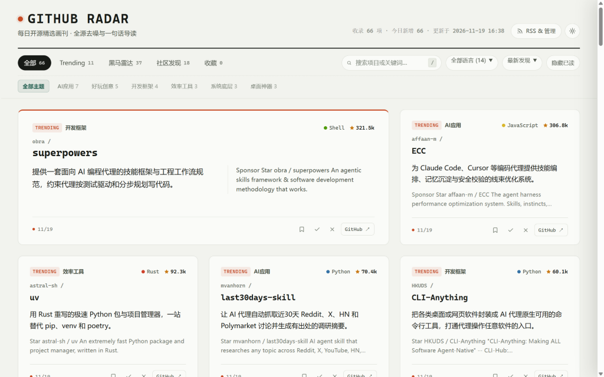
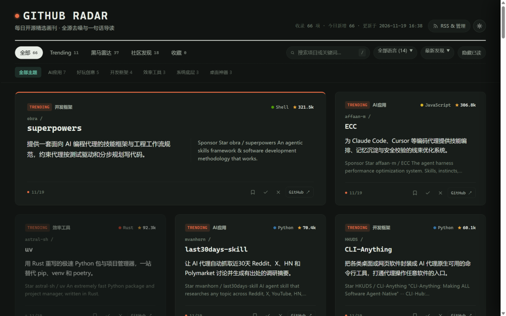
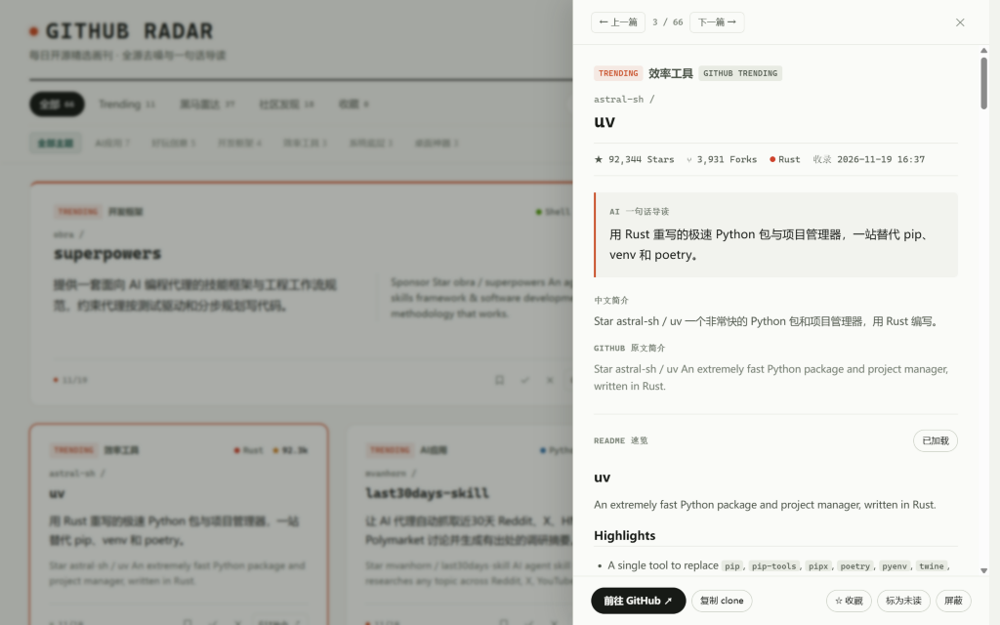

# GitHub Radar · 每日开源精选画刊

[](https://www.python.org/)
[](#快速开始)
[](#效果展示)
[](./LICENSE)

**GitHub Radar** 是一个轻量级、可自托管的开源项目发现与中文导读工具。它自动聚合 **GitHub Trending、GitHub 定向检索（低星黑马）、关注开发者 Star 动态、Show HN、HelloGitHub、Reddit 及自定义 RSS** 等多路来源，经过跨源去重、黑名单与反刷星过滤、免费中文翻译以及可选的批量 AI 一句话亮点提炼后，同时输出 **杂志风静态 Web 画刊** 与 **标准 RSS 2.0 订阅源**。

---

## 核心特性

- **多源雷达聚合**：覆盖 GitHub Trending、GitHub Search（新锐黑马 / 冷门宝藏）、指定开发者 Star 追踪、Hacker News `Show HN`、HelloGitHub、Reddit（`r/opensource`、`r/SideProject`、`r/selfhosted`）及自定义 RSS/Atom。
- **硬核去噪过滤**：
  - 跨源按 `owner/repo`（大小写不敏感）合并去重，汇总多来源标签并保留最高 Star / Fork 与完整讨论链接。
  - 自动过滤 Profile README（`owner == repo`）、无编程语言的纯文档仓库、过老僵尸仓库以及异常刷星项目（高 Star 但零 Fork 零 Issue 的新仓库）。
  - 内置可配置黑名单，精准拦截 `awesome-*` 合集、八股面试、毕设模板、Prompt 堆砌引流与灰产脚本。
- **增量缓存 + 免费双语导读**：
  - 使用 SQLite（`data/radar.db`）持久化已收录项目，重复抓到仅刷新热度指标，不重复翻译或消耗 AI 额度。
  - 默认内置免费翻译接口（Google `gtx` + MyMemory 兜底），自动跳过已是中文的项目。
  - 支持通过 `agy` CLI 进行单批次结构化 AI 评审（输出 2~6 字中文主题标签 + 一句话大白话亮点 + 语义垃圾过滤）；未配置时自动降级或通过 `--no-ai` 关闭。
- **双端消费体验（Web 画刊 + RSS 2.0）**：
  - **Web 画刊**：零构建纯静态前端（HTML/CSS/JS），支持分栏切换、主题胶囊筛选、编程语言与关键词检索、右侧滑出详情抽屉（支持在线拉取 GitHub README 预览与一键复制 `git clone`）、浅色/深色模式、本地收藏/已读/屏蔽（`localStorage` 持久化）及键盘快捷键。
  - **RSS 订阅**：输出全源聚合及 3 个互不重复的分榜 RSS 2.0 XML（`all_discoveries.xml`、`github_trending.xml`、`github_radar.xml`、`community_picks.xml`），附带 `feeds.opml` 便于导入 FreshRSS 等阅读器。
- **极简部署**：Python 后端仅依赖 `PyYAML`，Web 端仅需 48MB 内存限制的 `nginx:alpine` 容器即可托管。

---

## 效果展示

### 浅色画刊视图（Light Editorial Mode）



### 深色阅读模式（Dark Mode，快捷键 `D`）



### 右侧项目详情抽屉 & README 在线速览

点击任意项目卡片即可滑出详情抽屉，查看 AI 一句话导读、双语简介、来源标签，支持在线拉取并渲染 GitHub README、一键复制 `git clone` 命令以及 `←` / `→` 连续翻篇：



---

## 工作流程

```text
多源采集 (GitHub Trending / Search / Starred / Show HN / HelloGitHub / Reddit & RSS)
   │
   ▼
GitHub 元信息补充 (enrich_github_metadata，内置未认证配额保护)
   │
   ▼
跨源合并去重 + 结构化/黑名单/反刷星去噪 (radar/filters.py)
   │
   ▼
SQLite 增量比对 (data/radar.db) ──► 仅对新仓库执行中文翻译 & 可选批量 AI 亮点提炼
   │
   ▼
输出 feeds/data.json + 4 份 RSS 2.0 XML ──► Nginx 静态画刊 / FreshRSS 订阅
```

---

## 目录结构

```text
github-radar/
├── run.py                  # CLI 入口（支持 --no-ai / --export-only / --config）
├── config.yaml             # 数据源、去噪黑名单、翻译、AI 亮点与输出配置
├── requirements.txt        # Python 依赖（PyYAML>=6.0）
├── docker-compose.yml      # Nginx 静态画刊与 Feeds 服务编排
├── nginx.conf              # Nginx 站点与 /feeds/ 跨域、缓存配置
├── feeds.opml              # RSS 分榜 OPML 导入模板（可按需替换服务地址）
├── radar/
│   ├── config.py           # YAML 配置加载
│   ├── models.py           # RepoItem 数据模型
│   ├── sources.py          # 多源抓取与 GitHub 元信息补充
│   ├── filters.py          # 跨源去重与规则去噪
│   ├── translator.py       # 免费中文翻译与批量 AI 亮点生成
│   ├── feed_builder.py     # RSS 2.0 XML 与 Web data.json 生成
│   └── pipeline.py         # SQLite 持久化与主流水线编排
├── web/
│   ├── index.html          # 画刊页面结构
│   ├── styles.css          # 浅色/深色主题与响应式排版样式
│   └── app.js              # 筛选、抽屉、README 预览、本地阅读状态与快捷键
└── tests/
    └── test_radar.py       # 解析、去噪、去重与输出回归测试
```

---

## 快速开始

### 1. 环境要求

- Python **3.9+**
- 依赖安装：

```bash
git clone https://github.com/confizhou-dotcom/github-radar.git
cd github-radar
pip install -r requirements.txt
```

### 2. 运行采集流水线

```bash
# 仅使用内置免费翻译（不调用 AI 亮点生成）
python run.py --no-ai

# 启用 AI 一句话亮点与语义去噪（需本机已安装并登录 agy CLI，可在 config.yaml 中配置）
python run.py

# 不抓取网络，仅从已有 data/radar.db 重新导出 RSS 与 data.json
python run.py --export-only
```

执行完成后，将在项目目录下自动生成：
- `data/radar.db`：SQLite 历史仓库与翻译缓存
- `data/status.json`：最近一次执行统计
- `feeds/data.json`：Web 前端读取的 JSON 数据
- `feeds/*.xml`：4 份标准 RSS 2.0 订阅文件

### 3. 启动 Web 画刊预览

#### 方式 A：Docker Compose（推荐生产部署）

```bash
docker compose up -d
```

服务启动后访问 `http://localhost:8088/` 即可浏览画刊，`http://localhost:8088/feeds/all_discoveries.xml` 等路径即为 RSS 订阅地址。

#### 方式 B：本地快速静态预览（无需 Docker）

确保当前目录结构下已存在 `feeds/` 和 `web/`，可使用任意静态服务器将根目录映射到 `web/` 并挂载 `/feeds/`（生产环境建议使用随附的 `docker-compose.yml` + `nginx.conf`）。

### 4. 定时自动更新（可选）

可通过系统 Crontab 或计划任务每日定时执行（例如每天凌晨 03:30）：

```cron
30 3 * * * cd /path/to/github-radar && /usr/bin/python3 run.py >> /var/log/github-radar.log 2>&1
```

---

## 配置说明（`config.yaml`）

| 配置项 | 说明 |
| --- | --- |
| `sources.github_trending` | 配置要抓取的语言列表（`""` 为全语言总榜）、时间维度（`daily`/`weekly`/`monthly`）与上限 |
| `sources.github_search.queries` | 自定义多组雷达检索策略（如创建天数、近期活跃天数、Star 区间） |
| `sources.starred_users` | 填入你想追踪的 GitHub 用户名列表，收集他们最近 Star 的项目 |
| `sources.hackernews_show` / `hellogithub` / `reddit_rss` | 独立开关与抓取条数配置 |
| `sources.extra_rss_urls` | 追加任意自定义 RSS / Atom 订阅链接（自动从中提取 GitHub 仓库链接） |
| `filters` | 控制编程语言门槛、仓库最大年限、反刷星检测与 `blacklist_keywords` 黑名单 |
| `translation` | 启用/禁用免费中文翻译（默认 `google_gtx` + MyMemory 备用） |
| `ai_highlight` | 配置 `agy_executable` 路径、模型名称、单批最大条数与超时时间 |
| `output` | 控制 RSS/Web 最大展示条数及 RSS `<link>` 使用的 `public_base_url` |

> **FreshRSS 联动说明**：如在同一主机运行名为 `github-radar-freshrss` 的 FreshRSS 容器，`run.py` 会在每次采集完成后自动尝试触发该容器立即刷新订阅（可通过 `--freshrss-user` 指定用户名）；也可导入 `feeds.opml`（导入前请将 `feed-server:80` 替换为你的实际地址）。

---

## Web 快捷键一览

| 快捷键 | 功能 |
| --- | --- |
| `/` | 聚焦顶部搜索框 |
| `D` | 切换浅色 / 深色阅读模式 |
| `←` / `→` | 在详情抽屉中切换上一篇 / 下一篇 |
| `S` | 在详情抽屉中收藏 / 取消收藏当前项目 |
| `Esc` | 关闭详情抽屉、弹窗或退出搜索框聚焦 |

---

## 运行测试

```bash
python -m unittest discover -s tests -v
```

---

## 开源协议

本项目基于 [MIT License](./LICENSE) 开源。
