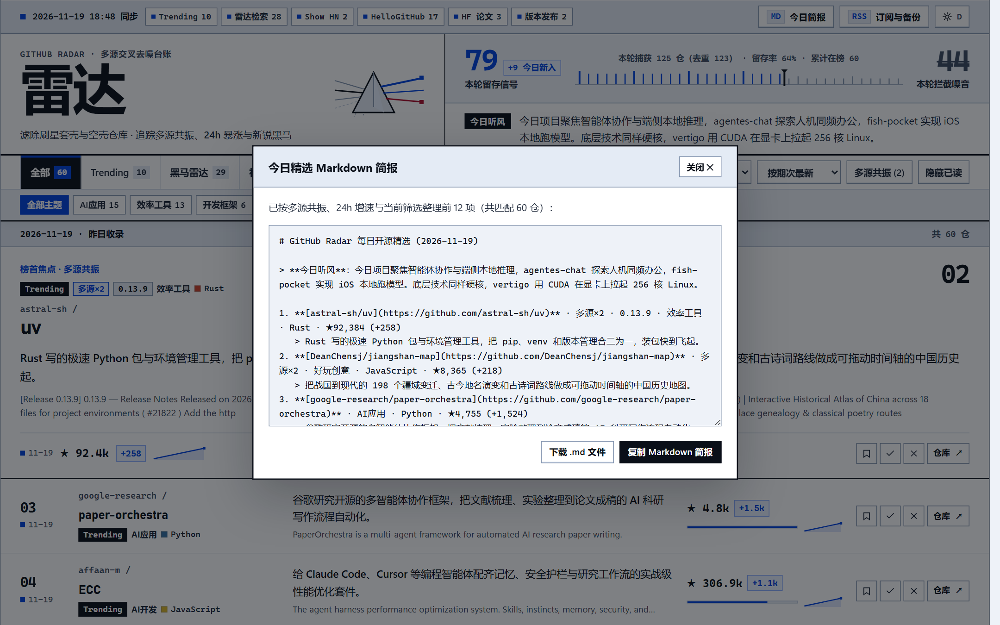

# GitHub Radar · 每日开源去噪信号台账

[](https://github.com/confizhou666/github-radar/actions/workflows/ci.yml)
[](https://confizhou666.github.io/github-radar/)
[](https://www.python.org/)
[](./pyproject.toml)
[](#效果展示)
[](./LICENSE)

**GitHub Radar** 是一个轻量级、支持**零服务器部署**的开源项目发现、反刷星去噪与中文导读工具。它每天自动聚合 **GitHub Trending、GitHub 定向检索（新锐黑马 / 冷门宝藏）、关注开发者 Star 动态、Show HN、HelloGitHub、HuggingFace Daily Papers、GitHub Releases、自建 RSSHub / Reddit 及自定义 RSS** 等多路信源，完成跨源共振加权、刷星套壳拦截、**24h/7d Star 增速与爆发速率追踪**、免费并发中文翻译、**本地确定性规则分类兜底**及可选大模型一句话导读，最终输出 **光学信号台账 Web 站点**、**标准 RSS 2.0 / JSON Feed 1.1 订阅源**、**`/llms.txt`** 与 **多平台 Webhook 每日简报**。

在线演示站点：**[https://confizhou666.github.io/github-radar/](https://confizhou666.github.io/github-radar/)**

---

## 核心特性

- **多源交叉聚合与共振排序**：
  - 覆盖 GitHub Trending（精准解析仓库简介与今日新增 Star）、GitHub Search（新锐黑马 / 冷门宝藏）、指定开发者 Star 追踪（`starred_users`）、Hacker News `Show HN`、HelloGitHub、**HuggingFace Daily Papers**（附开源仓库的前沿论文）、**GitHub Releases Atom 追踪**、任意域名自建 RSSHub / Reddit 及自定义 RSS/Atom。
  - 跨源按 `owner/repo` 合并去重，标出 `多源×N` 共振印记，按 `(多源命中数, 24h 增速, 总 Star)` 优先排序；通过 **GitHub GraphQL v4（50 仓/批）+ REST 容错回退** 高效补全非 API 源的星标、语言、Topics、开源协议与创仓时间。
- **硬核反刷星去噪 + 噪音负向缓存**：
  - 自动拦截 Profile README（豁免 `ollama/ollama`、`duckdb/duckdb` 等正规组织同名主仓）、纯文档空仓、过老僵尸仓库、`min_stars` 低星草稿仓以及伪装成桌面安装器/外挂壳的异常刷星簇（`anti_star_farm`）。
  - 支持 `whitelist_repos`、`blacklist_owners` 与英文词边界安全关键词黑名单；补全元信息后被淘汰的噪音仓自动写入 SQLite `kept=0` 负向缓存，7 日内免重复消耗 GitHub API 配额（后续若星标真实爆发可自动复活）。
- **统一 `Asia/Shanghai` 业务时区与 Star 轨迹追踪**：
  - 工作流与流水线默认统一使用 `Asia/Shanghai` 业务时区（可通过 `output.timezone` 或 `RADAR_TIMEZONE` 自定义），彻底消除云端 UTC 凌晨运行导致的快照日期与浏览器分组跨日错位。
  - `data/radar.db` 每日记录星标快照，计算 `stars_delta_24h`、`stars_delta_7d`、7 日 Sparkline 与黑马爆发速率（`stars / max(age_days, 1)`），并对次日未上榜旧项目的历史日增幅自动衰减归零。
- **零密钥开箱即用 + 可选大模型深度导读**：
  - **零密钥默认闭环**：内置免费 Google `gtx` + MyMemory 多线程并发中文翻译，配合**本地确定性规则分类器**（基于 `topics + language + description` 精准映射 `AI应用 / 模型推理 / 系统底层 / 数据存储 / 安全网络 / 桌面工具 / 创意玩具 / 开发框架 / 效率工具`）与数据驱动「今日听风」导语——无需配置任何大模型密钥，线上主题筛选条、分类防霸榜配额（`max_category_share`）与 Agent Skill 均 100% 可用。
  - **可选大模型增强**：配置任意 **OpenAI 兼容接口密钥**（`RADAR_AI_API_KEY`，支持 DeepSeek / Gemini / SiliconFlow / OpenAI / 本地 Ollama）或本地 `agy` CLI，即可自动解锁一句话白话亮点、存量无标回填与 AI 二次套壳过滤。
- **光学信号台账 Web 界面 (v7)、多制式订阅与 AI Agent 生态**：
  - **Web 信号台账**：零构建原生前端，配备首屏**本轮留存 vs 拦截游标尺**、顶栏信源健康度筛选胶囊、榜首双焦点对决台 + 结构化台账行、URL 深链状态同步、技术档案抽屉（7 日轨迹、免限流 CDN 安全 README 预览、一键 `git clone`）、Markdown 简报生成及浏览器阅读状态导入导出。
  - **多制式订阅与 Agent 直读**：同步输出 4 路 RSS 2.0 分榜 XML、`feeds.opml`、**JSON Feed 1.1 (`feeds/feed.json`)**、站点根目录 **`/llms.txt`**，并内置零后端 [`skills/github-radar/SKILL.md`](skills/github-radar/SKILL.md)。
  - **安全分片消息推送**：支持通用 Webhook、飞书交互卡片、钉钉、企业微信（4096 UTF-8 字节安全分片）、Discord（2000 字符分片）、Telegram（HTML 转义安全模式）。

---

## 效果展示

### 浅色光学信号台账（游标尺信噪监控 · 双焦点对决台 · 主题配额筛选）


### 深色黑曜石盘面（快捷键 `D`）


### 今日精选 Markdown 简报弹窗



### 仓库技术档案抽屉（参数矩阵 · 7 日轨迹 · 安全 README 预览）


---

## 工作流程

```text
多源并发采集 (Trending / Search / Starred / Show HN / HelloGitHub / HF Papers / Releases / RSSHub & RSS)
   │
   ▼
跨源合并去重 + 本地零成本黑白名单预筛 + SQLite kept=0 噪音负向缓存短路（省 API 配额）
   │
   ▼
GitHub 元信息批量补全 (GraphQL v4 50仓/批 + REST 容错回退，补全星标 / 语言 / Topics / 协议 / 创仓时间)
   │
   ▼
完整反刷星与结构去噪过滤 (min_stars>=5 · 拦截盗版安装器壳仓 · 词边界防误伤 · Releases 年龄豁免)
   │
   ▼
Asia/Shanghai 业务时区对齐 & 每日 Star 快照 (data/radar.db) ──► 计算 24h / 7d 增速 + 非活跃增速衰减清零
   │
   ▼
多线程并发免费中文翻译 + 可选分块大模型导读 (OpenAI 兼容 / agy CLI) + 本地确定性规则分类兜底
   │
   ▼
分类防霸榜配额 (<=40%) ──► data.json + feed.json + 4 路 RSS + feeds.opml + llms.txt + 状态压缩备份 + 分片通知
```

---

## 目录结构

```text
github-radar/
├── .github/
│   ├── workflows/
│   │   ├── ci.yml              # Push/PR 自动门禁（Ruff + JS 语法校验 + 后端单测 + Playwright 冒烟）
│   │   └── radar.yml           # 每日定时采集、前端/代码改动自动更新 Pages 与双重状态容灾
│   ├── ISSUE_TEMPLATE/         # 结构化 Bug 反馈与功能建议表单模板
│   ├── PULL_REQUEST_TEMPLATE.md
│   └── dependabot.yml          # pip 与 GitHub Actions 每周依赖安全检查
├── skills/github-radar/
│   └── SKILL.md                # 零后端 AI Agent Skill（直接读取线上 Pages JSON / llms.txt）
├── radar/
│   ├── config.py               # YAML 配置与 Asia/Shanghai 业务时区解析
│   ├── models.py               # RepoItem 数据模型
│   ├── sources.py              # 多线程多源抓取、自定义域名 RSSHub 兼容与 GraphQL/REST 补全
│   ├── filters.py              # 跨源去重、词边界黑白名单、反刷星与黑马爆发速率计算
│   ├── translator.py           # 并发免费翻译、确定性中文规则分类器与 OpenAI/agy 分块导读
│   ├── feed_builder.py         # 分类防霸榜配额、RSS 2.0、JSON Feed 1.1、OPML、llms.txt 与 data.json
│   ├── notifier.py             # 飞书 / 钉钉 / 企微 / Discord / Telegram(HTML) 按字节安全分片推送
│   └── pipeline.py             # SQLite 持久化、噪音负向缓存、分类回填、状态备份恢复与流水线编排
├── web/
│   ├── index.html              # 光学信号台账页面结构（含 SEO / OpenGraph / Twitter Card 元标签）
│   ├── styles.css              # 浅色/深色盘面、游标尺、对决台、台账流与响应式样式
│   ├── app.js                  # 单次/累计口径遥测、信源/主题筛选、URL 深链、安全 README 预览与本地备份
│   └── og-preview.png          # 1200×630 OpenGraph 社交分享预览图
├── tests/
│   ├── test_radar.py           # 后端反刷星、规则分类器、跨日时区、负向缓存、分片通知与状态恢复单测
│   └── test_web_smoke.py       # Playwright 无头 Chromium 前端交互、防 XSS 与移动端零溢出冒烟测试
├── pyproject.toml              # PEP 621 标准包元数据、开发依赖与 Ruff 配置
├── requirements.txt            # 生产环境极简依赖（PyYAML>=6.0）
├── config.yaml                 # 网络代理、数据源、过滤阈值、AI 引擎、时区、分类配额与推送配置
├── run.py                      # CLI 入口（--no-ai / --export-only / --restore-state / --notify-dry-run）
├── CONTRIBUTING.md             # 贡献指南与本地验证流程
├── SECURITY.md                 # 安全边界说明与私密漏洞报告策略
└── CODE_OF_CONDUCT.md          # 社区行为准则
```

---

## 零服务器部署（GitHub Actions + Pages）

仓库自带 [.github/workflows/radar.yml](.github/workflows/radar.yml)，Fork 本仓库即可零成本托管：

1. 进入仓库 **Settings → Pages**，将 **Source** 设置为 **GitHub Actions**。
2. **零密钥直接可用**：默认内置 `GITHUB_TOKEN` 自动完成 GitHub GraphQL 批量元信息补全，配合免费并发翻译与本地确定性规则分类器，无需配置任何额外密钥即可产出完整中文信号台账、分类标签、RSS 与 `/llms.txt`；同时随 `_site` 自动生成压缩状态快照实现双层容灾。
3. 如需开启**大模型一句话深度导读**或**消息推送**，可在 **Settings → Secrets and variables → Actions** 中按需添加可选 Secrets：
   - `RADAR_AI_API_KEY`：任意 OpenAI 兼容大模型 API Key（如 DeepSeek、SiliconFlow、Gemini OpenAI 兼容端点或 OpenAI）
   - `RADAR_AI_BASE_URL`：接口地址（如 `https://api.deepseek.com/v1`，默认 `https://api.openai.com/v1`）
   - `RADAR_AI_MODEL`：模型名称（如 `deepseek-chat` 或 `gpt-4o-mini`）
   - `RADAR_WEBHOOK_URL`：开启 `notifications.enabled: true` 后接收飞书 / 钉钉 / 企微 / Discord 简报
   - `RADAR_TG_BOT_TOKEN` / `RADAR_TG_CHAT_ID`：Telegram 机器人推送配置
4. 进入 **Actions → GitHub Radar Daily Build & Pages → Run workflow** 手动触发首次构建；之后每天北京时间 `03:30` 自动采集发布，且后续推送 `web/**` 或核心配置至 `main` 分支时会自动免打扰更新 Pages。

---

## 本地快速开始与 Docker 部署

```bash
git clone https://github.com/confizhou666/github-radar.git
cd github-radar
python -m pip install -r requirements.txt

# 零密钥模式：使用内置免费并发翻译 + 本地确定性规则分类
python run.py --no-ai

# 启用 AI 导读并在终端预览每日简报（不发送外部 Webhook）
python run.py --notify-dry-run

# 不请求外部网络，仅从已有 data/radar.db 重新应用过滤/分类规则并导出静态产物
python run.py --export-only
```

Docker Compose 部署静态站点（或连同定时采集容器一并启动）：

```bash
# 仅启动 48MB 超轻量 Nginx 静态台账服务
docker compose up -d

# 可选：同时启动后台定时采集容器（默认每 24 小时执行一次）
docker compose --profile collector up -d
# 访问 http://localhost:8088/
```

---

## 配置说明（`config.yaml`）

| 配置项 | 说明 |
| --- | --- |
| `network` | 可选 `proxy`（或 `RADAR_PROXY`）与 `github_token_env`（默认读取 `GITHUB_TOKEN`），提升 API 限流配额 |
| `sources.github_trending` | 抓取语言列表（`""` 为全语言总榜）、时间维度（`daily`/`weekly`/`monthly`）与条数上限 |
| `sources.github_search.queries` | 自定义多组黑马检索策略（创建天数、最近推送天数、Star 区间等） |
| `sources.starred_users` | 追踪指定 GitHub 开发者最近 Star 的项目，顶栏可按「关注开发者」一键筛选 |
| `sources.huggingface_papers` | 抓取 HuggingFace Daily Papers 中附带 GitHub 开源仓库的前沿论文项目 |
| `sources.github_releases` | 通过 Atom 零配额追踪核心开源工具的最新 Release 版本动态 |
| `sources.reddit_rss` / `extra_rss_urls` | 默认关闭公共 Reddit 直连（防云端 404/429）；支持任意域名自建 RSSHub、`{subreddit}` 模板及自定义 RSS/Atom |
| `filters` | 配置 `min_stars`（默认 `5`）、`whitelist_repos`、`blacklist_owners`、`anti_star_farm` 与词边界关键词黑名单 |
| `translation` | 启用/禁用免费中文并发翻译（默认 `google_gtx` + MyMemory 备用） |
| `ai_highlight` | 支持 `provider: auto \| openai \| agy`、分块导读与存量回填；未配置密钥时自动无缝回退本地确定性规则分类 |
| `notifications` | 配置推送开关、`provider`（`generic`/`feishu`/`dingtalk`/`wecom`/`discord`/`telegram`）、分类配额与安全分片 |
| `output` | 控制 `timezone`（默认 `Asia/Shanghai`）、RSS/Web 条数上限、`max_category_share` 防霸榜配额与 `public_base_url` |

---

## Web 快捷键一览

| 快捷键 | 功能 |
| --- | --- |
| `/` | 聚焦顶部检索框 |
| `D` | 切换浅色 / 深色光学盘面 |
| `←` / `→` | 在仓库技术档案抽屉中切换上一项 / 下一项 |
| `S` | 在仓库技术档案抽屉中收藏 / 取消收藏当前项目 |
| `Esc` | 关闭档案抽屉、简报/订阅弹窗或退出检索框聚焦 |

---

## 质量门禁与运行测试

安装开发测试工具并运行全套检查（与 GitHub Actions `ci.yml` 完全一致）：

```bash
python -m pip install -e ".[dev]"
python -m playwright install chromium

# Ruff 静态检查 + 前端语法检查 + 后端回归单测 + 无头浏览器前端冒烟测试
ruff check .
node --check web/app.js
NO_PROXY=127.0.0.1,localhost RADAR_REQUIRE_BROWSER_SMOKE=1 python -m unittest discover -s tests -v
```

欢迎提交 Issue 或 PR，详见 [贡献指南 (CONTRIBUTING.md)](./CONTRIBUTING.md) 与 [安全策略 (SECURITY.md)](./SECURITY.md)。

---

## 开源协议

本项目基于 [MIT License](./LICENSE) 开源。
